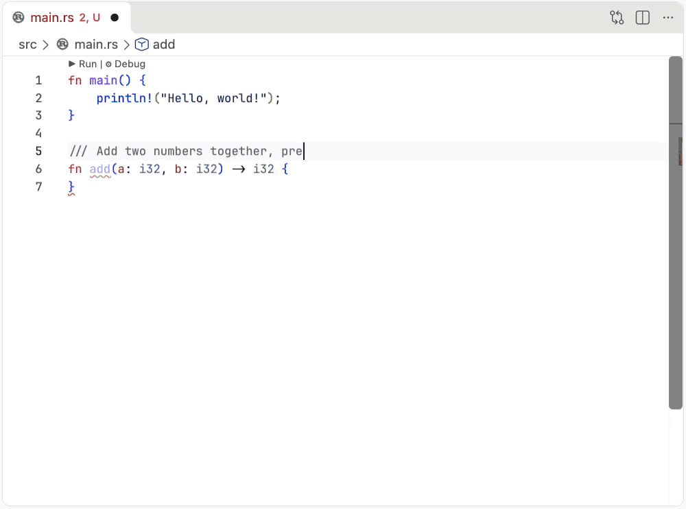

# Column 80

Local AI coding in VS Code. Small models, real context, your compiler checking every line. No chat window, no account, no bill.

<!-- Hero GIF: Rust, cut from a screen recording, 20s at 1000px.
The planned C# hero (dictate, refine, generate, LINQ naming
StockLine.ShortfallValue) is still blocked on roadmap item 90.
Brief: ~/repos/demo-csharp-app/RECORDING.md -->



A doc comment becomes the body. Add one rule to the comment, regenerate, review the diff. Then tests arrive with every expected value blanked, and you type the answers.

- **Runs on your box.** Ollama and two local models. Nothing leaves the machine unless you point it at a cloud key yourself.
- **No chat.** Every model write arrives as a diff you accept or reject. One function at a time.
- **The compiler reviews it.** Your own toolchain runs on accept. Broken code gets a repair round, not a shrug.

## Install

1. Install [Ollama](https://ollama.com).
2. Install Column 80 from the [VS Code marketplace](https://marketplace.visualstudio.com/items?itemName=utilitydelta.column-80), or press <kbd>Ctrl</kbd>+<kbd>P</kbd> and run `ext install utilitydelta.column-80`.
3. First activation probes your GPU, picks a tier, and offers the models it needs. One click. It never pulls a model without your say so.

Run `Column 80: Select Hardware Tier` any time to redo that.

## What you need

- VS Code 1.85 or later.
- [Ollama](https://ollama.com) running locally.
- For function generation: an NVIDIA GPU with 12GB or more, or an Apple Silicon Mac with 16GB or more. A 16GB M-series MacBook Pro runs it. More memory gets a bigger model.
- A working toolchain for your language. Column 80 leans on it hard.

Small card, Intel Mac, or no GPU? Autocomplete still works, and for function generation point column-80 at a cloud API key or your Claude Code subscription.

## The gestures

### Autocomplete

Ghost text as you type. <kbd>Tab</kbd> accepts. At a member access it uses the real members from your language server instead of guessing at them.

### Generate a function body

Write the signature and a doc comment that spells out the edge cases and the invariants. Top level comments inside your function are also included. Then run `Column 80: Generate Function Body`.

The same gesture on a struct, enum, class or interface header generates the type from its doc comment.

### Criticize a function

Score your function. Writes comments giving you advice on where to improve, eg:

`// C80 clock: hidden wall-clock read. Untestable. Pass it in.`

### Dictate

Put the cursor where the next block goes, press <kbd>Shift</kbd>+<kbd>Alt</kbd>+<kbd>D</kbd>, say what it does, press it again. The sentence never enters the file. The code lands on its own. Local whisper.cpp, downloaded on first use.

### Tests that decide what correct means

`Column 80: Generate Tests (TDD)` writes tests blind of your implementation and blanks every expected value. You tab through the holes and type each answer yourself. The model's guess is never inserted.

`Column 80: Run Covering Tests` walks the call hierarchy upward and runs the tests in your repo that actually reach your function. No name matching. Failing assertions feed the next repair, and only your function is ever rewritten.

### Model context, under your control

The Model Context panel in the Explorer sidebar shows everything the model will see. It starts empty and stays empty until you put something in it. Right-click to add a selection, the enclosing function, the enclosing block, or a whole file. Panel order is prompt order. Context is captured at generation time and blocks are dynamic, update the code and the context resizes to the new block size.

## Languages

Rust, C#/.NET, Python, TypeScript and Go.

Column 80 relies on each language's own toolchain and language server, which is why the list is short and why the ones on it work properly. Adding one is a real PR, and the [contributor guidelines](https://github.com/utilitydelta/column-80/blob/main/CONTRIBUTING.md) tell you how.

## Run it from source

```bash
git clone https://github.com/utilitydelta/column-80
cd column-80
npm install
```

Press <kbd>F5</kbd> to launch an Extension Development Host with it loaded.

## More

- [column80.dev](https://column80.dev) for why it works this way.
- [User manual](https://github.com/utilitydelta/column-80/blob/main/docs/user-manual.md) for every setting, every command and the known limits.
- [Issues](https://github.com/utilitydelta/column-80/issues) when it breaks.
- Apache-2.0. No sign-up, no telemetry, no data exfiltration.

---

// Understand every line you ship.

// Code is the design.

// Your code is not their training data.

// Your editor should not have a bill.

---

Local by architecture. No account, no telemetry, no bill. Apache-2.0
